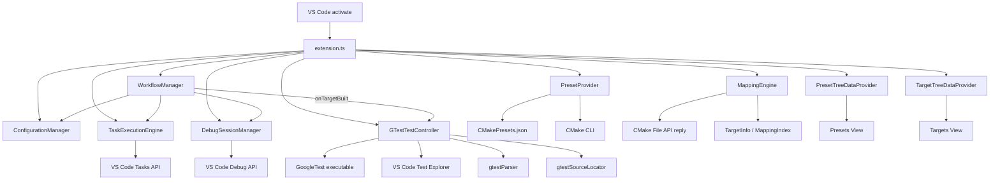

# 当前项目架构梳理

## 1. 项目定位

本项目是一个 VS Code Extension，面向基于 CMake 的 C/C++ 项目，提供以下完整工作流：

```text
选择 CMake Preset
    ↓
执行 Configure
    ↓
读取 CMake File API
    ↓
发现 Target 和源码映射
    ↓
Build Target
    ↓
Run / Debug Target
    ↓
发现并运行 GoogleTest
```

插件名称为 `CMake Runner`，当前版本 `0.4.9`，入口定义在 `package.json`：

```text
main: ./out/src/extension.js
```

激活事件：

```text
onWorkspaceContains:CMakePresets.json
onWorkspaceContains:CMakeUserPresets.json
onStartupFinished
```

TypeScript 源码位于 `src/`，编译输出位于 `out/`。`out/` 是生成目录，不应手工修改。

## 2. 总体分层

当前项目可以划分为以下几层：

```text
┌────────────────────────────────────────────┐
│ VS Code Extension Runtime                  │
│ activate / commands / TreeView / Test API  │
├────────────────────────────────────────────┤
│ UI Presentation Layer                      │
│ PresetTreeDataProvider                     │
│ TargetTreeDataProvider                     │
│ FilterMatcher                              │
├────────────────────────────────────────────┤
│ Workflow Orchestration Layer               │
│ WorkflowManager                            │
│ GTestTestController                        │
│ DebugSessionManager                        │
├────────────────────────────────────────────┤
│ Domain / Metadata Layer                    │
│ PresetProvider                             │
│ MappingEngine                              │
│ models.ts                                  │
│ gtestParser                                │
│ gtestSourceLocator                         │
├────────────────────────────────────────────┤
│ VS Code / OS Integration Layer             │
│ TaskExecutionEngine                        │
│ ConfigurationManager                       │
│ windowsTooling                             │
│ OutputLogger                               │
└────────────────────────────────────────────┘
```

当前分层并不是严格隔离的。其中 `extension.ts` 仍然承担较多状态管理、命令注册和 UI 编排职责。

## 3. 目录结构

```text
psgmrunner/
├─ package.json
├─ tsconfig.json
├─ README.md
├─ README-ALL.md
├─ CHANGELOG.md
├─ TESTING.md
├─ AGENTS.md
│
├─ src/
│  ├─ extension.ts
│  ├─ models.ts
│  ├─ utils.ts
│  │
│  ├─ services/
│  │  ├─ configurationManager.ts
│  │  ├─ debugSessionManager.ts
│  │  ├─ gtestParser.ts
│  │  ├─ gtestSourceLocator.ts
│  │  ├─ mappingEngine.ts
│  │  ├─ outputLogger.ts
│  │  ├─ presetProvider.ts
│  │  ├─ taskExecutionEngine.ts
│  │  ├─ testController.ts
│  │  ├─ windowsTooling.ts
│  │  └─ workflowManager.ts
│  │
│  └─ ui/
│     ├─ filterMatcher.ts
│     ├─ presetTreeDataProvider.ts
│     └─ targetTreeDataProvider.ts
│
├─ test/
│  ├─ utils.test.ts
│  ├─ models.test.ts
│  ├─ services.test.ts
│  ├─ gtestSourceLocator.test.ts
│  ├─ gtestParser.test.ts
│  ├─ testController.test.ts
│  ├─ ui.test.ts
│  ├─ integration.test.ts
│  ├─ workflow.test.ts
│  ├─ taskExecutionEngine.test.ts
│  ├─ windowsTooling.test.ts
│  ├─ manifest.test.ts
│  ├─ extension.test.ts
│  ├─ helpers.ts
│  ├─ test-files.js
│  ├─ run-unit.js
│  ├─ run-coverage.js
│  ├─ shim-register.js
│  ├─ vscode-mock.js
│  └─ vscode-shim.js
│
├─ resources/
├─ doc/
├─ dist/
└─ out/
```

## 4. 扩展入口：`extension.ts`

文件：

```text
src/extension.ts
```

这是整个插件的 Composition Root 和应用层入口，主要负责：

- 获取第一个 workspace folder
- 创建核心服务实例
- 保存当前 preset 和初始化状态
- 创建两个 TreeView
- 注册插件命令
- 监听当前编辑器变化
- 协调 Preset、Target、Workflow、GTest 之间的数据流

初始化的主要对象如下：

```text
activate()
  ├─ OutputLogger
  ├─ ConfigurationManager
  ├─ PresetProvider
  ├─ MappingEngine
  ├─ TaskExecutionEngine
  ├─ DebugSessionManager
  ├─ GTestTestController
  ├─ WorkflowManager
  ├─ PresetTreeDataProvider
  └─ TargetTreeDataProvider
```

核心状态由 `extension.ts` 直接维护：

```ts
let presets: PresetInfo[] = [];
let currentPreset: PresetInfo | undefined;
let initializationPromise: Promise<void> | undefined;
```

初始化流程如下：

```text
ensureInitialized()
  ├─ refresh()
  │   ├─ PresetProvider.loadPresets()
  │   ├─ 选择保存的 preset 或第一个 preset
  │   ├─ 更新 workspaceState
  │   └─ 更新 PresetTreeDataProvider
  │
  └─ updateTargets()
      ├─ MappingEngine.rebuild(currentPreset)
      ├─ 获取 targets
      ├─ 更新 TargetTreeDataProvider
      └─ 更新 GTestTestController
```

`initializationPromise` 用于避免多个命令并发触发重复初始化。

初始化是惰性的：只有当 Presets/Targets 视图可见（`onDidChangeVisibility`）、执行命令，或 Test Explorer 触发 `ensureInitialized` 回调时，才会真正加载 preset 和 target，避免拖慢 VS Code 启动。

## 5. Preset 解析：`PresetProvider`

文件：

```text
src/services/presetProvider.ts
```

职责：

- 读取 `CMakePresets.json`
- 读取 `CMakeUserPresets.json`
- 处理 `include`
- 处理 `inherits`
- 调用 CMake 的 `--list-presets`
- 过滤隐藏 preset
- 解析 `${sourceDir}` 等变量
- 将 configure preset 与 build preset 关联
- 转换为内部的 `PresetInfo`

读取路径：

```text
<workspaceRoot>/CMakePresets.json
<workspaceRoot>/CMakeUserPresets.json
```

同时查询 CMake 实际可见的 preset：

```text
cmake -S <workspaceRoot> --list-presets=configure
cmake -S <workspaceRoot> --list-presets=build
```

最终列表以文件解析出的 configure preset 为基础，CMake 列表作为可见性白名单：当 CMake 能列出 preset 时，只有被列出的 preset 会被保留（configure 与 build 两侧都会过滤）；当列表为空（例如 CMake 不可用）时，才退回按 `hidden` 字段过滤。

Preset 的关系如下：

```text
configure preset
    ├─ inherits
    ├─ include
    └─ matching build preset
         └─ configuration
```

输出模型：

```ts
interface PresetInfo {
  name: string;
  displayName: string;
  binaryDir: string;
  sourceDir: string;
  buildPresetName?: string;
  configuration?: string;
  description?: string;
}
```

Preset 的 `binaryDir` 会被解析为绝对路径，例如：

```json
{
  "binaryDir": "${sourceDir}/build/debug"
}
```

最终会转换为类似以下路径：

```text
D:/project/build/debug
```

CMake 可执行文件的解析顺序为：

```text
1. cmakerunner.cmakePath
2. Windows where.exe cmake
3. Visual Studio vswhere.exe
4. PATH 中的 cmake
```

## 6. CMake File API 与目标索引：`MappingEngine`

文件：

```text
src/services/mappingEngine.ts
```

这是项目的核心元数据解析组件。

### 6.1 输入数据

读取目录：

```text
<binaryDir>/.cmake/api/v1/reply/
```

核心文件链路：

```text
index-*.json
    ↓
codemodel-v2.json
    ↓
target-*.json
```

解析流程：

```text
File API index
    ↓
寻找 kind = codemodel 的对象
    ↓
读取 codemodel-v2
    ↓
遍历 configurations
    ↓
遍历 target references
    ↓
读取每个 target JSON
    ↓
过滤支持的 target 类型
    ↓
生成 TargetInfo
    ↓
建立源码到 target 的反向索引
```

目前支持的 target 类型：

```text
EXECUTABLE
SHARED_LIBRARY
UTILITY
```

目标模型：

```ts
interface TargetInfo {
  id: string;
  name: string;
  displayName: string;
  type?: string;
  configuration?: string;
  sourceFiles: string[];
  guessedExecutablePath: string;
}
```

源码映射索引：

```ts
interface MappingIndex {
  targets: Map<string, TargetInfo>;
  sourceToTargets: Map<string, string[]>;
}
```

查询方式：

```text
source file path
    ↓
normalizePath()
    ↓
sourceToTargets
    ↓
target IDs
    ↓
TargetInfo[]
```

例如：

```text
src/main.cpp
    ↓
app
```

### 6.2 多配置支持

当 codemodel 存在多个 configuration 时，target 会被区分为：

```text
app [Debug]
app [Release]
```

内部 key 类似：

```text
app::debug
app::release
```

### 6.3 可执行文件路径

优先使用 File API 返回的 artifact：

```json
{
  "artifacts": [
    {
      "path": "..."
    }
  ]
}
```

如果没有 artifact，则退化为：

```text
<binaryDir>/<targetName>
```

Windows 下会自动补充 `.exe`。

### 6.4 当前实现注意点

`rebuild()`（`src/services/mappingEngine.ts:62`）中会打印“falling back to compile_commands.json”的警告，但实际代码并没有读取 `compile_commands.json`。真实行为是：

```text
File API 解析出 target → 替换索引
File API 结果为空      → 保留上一次索引（初始为空索引）
File API 读取异常      → 保留上一次索引（初始为空索引）
```

后续应当实现真正的 fallback，或者删除误导性的日志。

## 7. 配置和命令模板：`ConfigurationManager`

文件：

```text
src/services/configurationManager.ts
```

职责：

- 读取 `cmakerunner.*` 配置
- 替换 configure/build/run 模板变量
- 解析调试程序路径
- 选择调试器配置
- 复用用户 `launch.json` 配置

配置来源：

```text
vscode.workspace.getConfiguration('cmakerunner')
```

支持的命令模板配置：

```text
cmakerunner.tasks.presetConfigureCommandTemplate
cmakerunner.tasks.buildCommandTemplate
cmakerunner.tasks.runCommandTemplate
cmakerunner.tasks.clearTerminalBeforeRun
```

Configure 变量：

```text
${buildDir}
${preset}
${sourceDir}
```

Build / Run 变量：

```text
${buildDir}
${preset}
${target}
${sourceDir}
${buildPreset}
${configuration}
${configurationArgument}
${buildPresetArgument}
${executablePath}
${quotedExecutablePath}
${executableCommand}
```

变量中的预构造片段包括：

```text
${configurationArgument}
  → --config Debug

${buildPresetArgument}
  → --preset debug-build

${executableCommand}
  Windows → & 'executable path'
  POSIX   → quoted executable path
```

模板替换时，若普通变量值包含空格会自动加双引号（预构造片段不会重复加引号），避免路径或名称带空格导致命令拼接错误。

### 7.1 Debug 配置选择顺序

```text
1. workspace launch.json 中兼容的 C/C++ launch 配置
2. CodeLLDB
3. Native Debug
4. Microsoft C/C++
5. 抛出错误
```

调试配置不会写回 `launch.json`，而是运行时动态生成，并通过 Debug API 启动。

## 8. Task 执行：`TaskExecutionEngine`

文件：

```text
src/services/taskExecutionEngine.ts
```

职责：

- 创建 VS Code `Task`
- 执行 build / configure / run
- 监听任务结束事件
- 返回退出码
- 注入 problem matcher
- 处理 Windows Visual Studio 编译环境
- 处理不同平台的命令包装

任务类型：

```text
vscode.Task
  └─ ShellExecution
```

Build 任务使用以下 problem matcher：

```text
$gcc
$msCompile
```

执行结果：

```ts
interface TaskExecutionResult {
  exitCode: number | undefined;
}
```

### 8.1 Windows

如果检测到 `vcvarsall.bat`，会包装 CMake 命令：

```bat
call "<vcvarsall.bat>" <arch> >nul 2>&1 && %SYSTEMROOT%\System32\chcp.com 65001 >nul 2>&1 && cmake ...
```

`<arch>` 根据 `process.arch` 选择：`ia32 → x86`、`arm64 → x64_arm64`、其它 `→ x64`。

查找路径：

```text
VSINSTALLDIR
    ↓
vswhere.exe
```

Windows 下的 cmake 命令始终通过 `%COMSPEC%`（默认 `cmd.exe`）以 `/d /s /c` 执行；未找到 `vcvarsall.bat` 时直接执行原命令，不再附加 Visual Studio 环境。

### 8.2 POSIX

对于 CMake build 命令，使用：

```sh
/bin/sh -c 'trap "exit 130" INT; cmake ...'
```

这样可以较好地保留 Ctrl+C 的退出码。

### 8.3 Run 工作目录

运行 target 时，会切换到 preset 的 binary directory。

Windows 使用 PowerShell 逻辑：

```powershell
Push-Location '<binaryDir>'
try {
  <command>
  $cmakerunnerExitCode = if ($LASTEXITCODE -is [int]) { $LASTEXITCODE } elseif ($?) { 0 } else { 1 }
}
finally {
  Pop-Location
}
exit $cmakerunnerExitCode
```

POSIX 使用子 shell 逻辑：

```sh
__cmakerunner_oldpwd="$PWD"; cd '<binaryDir>' && { <command>; __cmakerunner_status=$?; cd "$__cmakerunner_oldpwd"; exit $__cmakerunner_status; }
```

## 9. 工作流编排：`WorkflowManager`

文件：

```text
src/services/workflowManager.ts
```

这是面向业务动作的核心编排服务。

主要职责：

- Configure preset
- Build target
- Run target
- Debug target
- 构建成功后通过 `onTargetBuilt` 回调通知测试刷新
- 统一处理构建失败与耗时统计

### 9.1 Configure preset

```text
buildPreset(preset)
  ├─ 创建 CMake File API query
  ├─ 生成 configure 命令
  ├─ TaskExecutionEngine.executeBuild()
  └─ 返回 succeeded + durationMs
```

在 configure 前创建：

```text
<binaryDir>/.cmake/api/v1/query/codemodel-v2
```

### 9.2 Build target

```text
buildTarget(preset, target)
  ├─ buildTargetStep()
  │   ├─ 生成 build 命令
  │   ├─ 执行 VS Code Task
  │   └─ 构建成功后通过 onTargetBuilt 回调刷新 GTest
  │
  └─ 构建成功后提示：
      ├─ Run
      └─ Debug
```

### 9.3 Run target

```text
runTarget()
  ├─ 默认先 build
  ├─ 生成 run 命令
  ├─ 使用 binaryDir 作为运行目录
  └─ 执行 run task
```

### 9.4 Debug target

```text
debugTarget()
  ├─ 先 build
  ├─ 解析调试程序
  ├─ 创建 DebugConfiguration
  └─ DebugSessionManager.startDebugging()
```

### 9.5 GoogleTest 运行

v0.4.0 起 GoogleTest 的运行与调试已完全迁移到 VS Code Test Explorer，由 `GTestTestController` 处理，`WorkflowManager` 不再参与。构建成功后会通过 `onTargetBuilt` 回调触发一次 `discover()`，详见第 10 节。

## 10. GoogleTest 集成：`GTestTestController`

文件：

```text
src/services/testController.ts
```

该组件使用 VS Code Testing API，而不是自定义 GTest TreeView。

创建的测试控制器为：

```text
id:    cmakerunner.gtests
label: CMake Runner GTests
```

注册两个运行配置：

```text
Run   → TestRunProfileKind.Run
Debug → TestRunProfileKind.Debug
```

在 VS Code Test Explorer 中的层级为：

```text
Executable
  └─ Suite
      └─ Test Case
```

### 10.1 发现流程

```text
当前 preset
    ↓
当前 targets
    ↓
筛选 EXECUTABLE target
    ↓
筛选名字以 test 开头的可执行文件
    ↓
检查文件是否存在
    ↓
执行 --gtest_list_tests（15s 超时）
    ↓
gtestParser 解析 suite / case
    ↓
注册 Executable → Suite → Case 树
    ↓
异步扫描源码补全 case 的文件/行列位置
```

当前只自动识别名称以 `test` 开头的可执行文件，例如：

```text
test_math
TestNetwork
TEST_utils.exe
```

不会自动识别以下类型的名称：

```text
my_app
benchmark
```

### 10.2 测试用例解析

GoogleTest 输出：

```text
MathTest.
  Adds
  Divides
```

会转换为：

```ts
[
  {
    suite: 'MathTest',
    name: 'Adds',
    filter: 'MathTest.Adds'
  },
  {
    suite: 'MathTest',
    name: 'Divides',
    filter: 'MathTest.Divides'
  }
]
```

### 10.3 测试运行

VS Code Test Explorer 的 Run 请求会：

```text
1. 若测试树为空则先执行一次 discover()
2. 收集请求范围内的 case（支持 exclude）
3. 每个 case 单独启动进程：<executable> --gtest_filter=Suite.Case
4. 进程结束后把 stdout/stderr 追加到 TestRun 输出
5. exitCode == 0 → passed，否则 → failed
6. 取消检查发生在 case 之间，已取消的 case 标记为 skipped
7. 结束 TestRun
```

实际执行者是 `GTestTestController.run()`（`src/services/testController.ts:306`），每个 case 都会重新启动一次可执行文件，进程没有设置超时。

### 10.4 测试调试

多个属于同一 executable 的 case 会合并成一个过滤器：

```text
--gtest_filter=SuiteA.Test1:SuiteA.Test2
```

然后通过 `ConfigurationManager.createDebugConfiguration()` 动态构造调试配置并启动；调试配置会额外注入 `ASAN_OPTIONS=detect_leaks=0` 与 `LSAN_OPTIONS=detect_leaks=0`。调试器成功启动后，该组 case 会被直接标记为 passed，不等待调试会话结束。

### 10.5 测试源码定位

`gtestSourceLocator.ts` 会：

- 扫描 target 对应的 C/C++ 源文件（`.c/.cc/.cpp/.cxx/.h/.hh/.hpp/.hxx`）
- 匹配 `TEST`、`TEST_F`、`TEST_P`、`TYPED_TEST`、`TYPED_TEST_P` 宏
- 为 suite / name 生成候选变体（支持参数化前缀与类型化后缀）
- 支持 UTF-8、UTF-16、GBK、GB18030 等编码
- 将测试项绑定到源码文件与行列位置

定位是在用例注册完成后异步进行的：每个可执行文件的定位结果会缓存，并通过 generation 计数避免过期任务写回；节点较多时会按批次让出事件循环，避免阻塞界面。因此 Test Explorer 中的 GoogleTest case 可以跳转到对应测试宏。

## 11. Debug Session 管理：`DebugSessionManager`

文件：

```text
src/services/debugSessionManager.ts
```

职责：

- 统一调用 VS Code Debug API
- 追踪刚启动的 debug session
- 关联 debug session 创建的 terminal
- Debug session 结束时清理关联 terminal

基本流程：

```text
startDebugging()
  ├─ pendingSessionCount++
  ├─ vscode.debug.startDebugging()
  └─ 等待 onDidStartDebugSession
```

terminal 通过“当前关联 session 的 terminal 数量最少”策略进行归属。

## 12. UI 层

### 12.1 Preset Tree

文件：

```text
src/ui/presetTreeDataProvider.ts
```

视图：

```text
cmakerunner.presets
```

每个 preset 是一个扁平节点：

```text
Debug
Release
MinSizeRel
```

节点显示：

- displayName
- 当前选中状态
- binaryDir
- description
- 选择命令

当前 preset 使用 `check` 图标和 `Current` 描述，非当前 preset 使用 `gear` 图标和 preset name 描述。

### 12.2 Target Tree

文件：

```text
src/ui/targetTreeDataProvider.ts
```

视图：

```text
cmakerunner.targets
```

树结构：

```text
Target
  ├─ source1.cpp
  ├─ source2.cpp
  └─ source3.cpp
```

支持：

- target 名称过滤
- executable 名称过滤
- 源码文件名过滤
- 相对源码路径过滤
- 正则表达式过滤
- 当前编辑器源码高亮
- 根据当前编辑器自动 reveal 对应源码节点

当前文件联动流程：

```text
当前打开 src/app/main.cpp
    ↓
找到映射 target
    ↓
展开 Targets 树
    ↓
reveal 对应 SourceTreeItem
```

### 12.3 FilterMatcher

文件：

```text
src/ui/filterMatcher.ts
```

提供两种过滤：

```text
普通文本过滤：大小写不敏感 includes

正则过滤：new RegExp(query, 'i')
```

统一入口是 `createFilterMatcher(filterText, isRegex, normalizeValue)`，`normalizeValue` 由调用方注入：Targets 树会把路径分隔符统一为 `/`。`getRegexFilterError()` 供过滤 QuickPick 校验用户输入的正则是否合法，非法正则不会写回过滤器。

### 12.4 已移除的 `GTestTreeDataProvider`

v0.4.0 起 GoogleTest 已迁移到 VS Code Test Explorer；v0.4.9 清理了遗留的 `src/ui/gtestTreeDataProvider.ts` 以及基于 terminal 的测试执行路径。当前仓库不再包含该文件，GoogleTest 的唯一展示入口是 Test Explorer。

## 13. 关键数据流

### 13.1 插件初始化

```text
VS Code 激活
    ↓
activate()
    ↓
创建服务和视图
    ↓
视图可见 / 命令 / Test Explorer 触发 ensureInitialized()
    ↓
PresetProvider.loadPresets()
    ↓
选择当前 preset
    ↓
MappingEngine.rebuild()
    ↓
读取 File API
    ↓
TargetTreeDataProvider.setTargets()
    ↓
GTestTestController.setTargets()
```

### 13.2 Configure / Target 发现

```text
用户点击 Preset Build
    ↓
extension.ts 命令处理器
    ↓
WorkflowManager.buildPreset()
    ↓
创建 codemodel-v2 query
    ↓
ConfigurationManager 生成命令
    ↓
TaskExecutionEngine 创建 VS Code Task
    ↓
cmake --preset ...
    ↓
构建完成
    ↓
MappingEngine.rebuild()
    ↓
读取 codemodel
    ↓
刷新 Targets Tree
    ↓
刷新 Test Explorer
```

### 13.3 当前文件到 Target

```text
onDidChangeActiveTextEditor
    ↓
当前文件路径
    ↓
MappingEngine.findTargetsBySource()
    ↓
TargetTreeDataProvider.findFirstSourceItemByFile()
    ↓
TreeView.reveal()
```

### 13.4 Target Build / Run / Debug

```text
TargetTreeItem / SourceTreeItem
    ↓
extension command
    ↓
resolveTargetFromArgument()
    ↓
检查当前 preset
    ↓
WorkflowManager
    ├─ build
    ├─ run
    └─ debug
```

### 13.5 GoogleTest

```text
Preset + Target
    ↓
GTestTestController.setPreset() / setTargets()
    ↓
（Test Explorer 刷新、Run/Debug 或构建成功后）discover()
    ↓
筛选名字以 test 开头的 EXECUTABLE target
    ↓
--gtest_list_tests（gtestParser 解析）
    ↓
注册 Executable → Suite → Case
    ↓
异步 gtestSourceLocator 补全源码位置
    ↓
Test Explorer
    ├─ Run
    └─ Debug
```

## 14. 外部依赖和 API 使用

### 14.1 VS Code API

项目主要依赖以下 VS Code API：

```text
workspace
workspace.fs
workspaceState
window.createTreeView
window.createQuickPick
window.showQuickPick
window.onDidChangeActiveTextEditor
window.onDidOpenTerminal
commands.registerCommand
commands.executeCommand
tasks.executeTask
tasks.onDidEndTask
tasks.onDidEndTaskProcess
debug.startDebugging
debug.onDidStartDebugSession
debug.onDidTerminateDebugSession
tests.createTestController
extensions.all
```

### 14.2 操作系统依赖

Windows：

```text
where.exe
vswhere.exe
vcvarsall.bat
cmd.exe
PowerShell
```

POSIX：

```text
/bin/sh
```

### 14.3 CMake 依赖

```text
cmake -S <workspaceRoot> --list-presets=configure
cmake -S <workspaceRoot> --list-presets=build
cmake --preset <preset>
cmake --build <binaryDir> --target <target>
```

### 14.4 CMake File API

```text
codemodel-v2
```

### 14.5 GoogleTest 依赖

```text
<test-executable> --gtest_list_tests
<test-executable> --gtest_filter=<filter>
```

## 15. 测试架构

### 15.1 单元测试

```text
utils.test.ts
models.test.ts
services.test.ts
gtestSourceLocator.test.ts
gtestParser.test.ts
testController.test.ts
ui.test.ts
windowsTooling.test.ts
```

覆盖：

- 数据模型
- 路径和模板工具（含自动加引号、命令解析）
- 配置管理、调试配置选择与日志
- TreeDataProvider
- GoogleTest 名称识别
- `--gtest_list_tests` 输出解析
- 测试源码定位
- Windows 工具链查找

### 15.2 工作流测试

```text
workflow.test.ts
taskExecutionEngine.test.ts
```

覆盖：

- configure / build / run / debug 编排
- 任务退出码与取消
- 构建失败后的错误提示与中断
- Windows 命令包装（`vcvarsall.bat`、`cmd.exe` 回退）
- POSIX 命令包装与退出码保留
- 运行工作目录包装（Windows / POSIX）
- 调试器启动与 `launch.json` 不被改写

### 15.3 集成测试

```text
integration.test.ts
manifest.test.ts
extension.test.ts
```

覆盖：

- Preset 文件解析
- include / inherits
- CMake File API fixture
- 多 configuration target
- package.json 激活事件
- extension command 注册
- 当前文件到 target 的关联与 QuickPick 过滤
- TreeView 状态
- Test Explorer Controller 注册

### 15.4 VS Code Mock

测试通过以下文件模拟 VS Code API：

```text
test/vscode-mock.js
test/vscode-shim.js
```

统一入口为：

```text
npm test
  → test/run-unit.js
      → test/test-files.js 自动发现 out/test/**/*.test.js
```

新增 `test/*.test.ts` 无需手工登记，未列入 `preferredOrder` 的套件会自动追加到末尾。最近一次实测结果（2026-09-14）：

```text
13 suites
149 passing
```

## 16. 当前架构的主要优点

### 16.1 依赖注入相对清晰

`WorkflowManager`、`TaskExecutionEngine`、`ConfigurationManager` 等服务通过构造函数接收依赖，便于测试替换。

### 16.2 CMake 元数据和 UI 解耦较好

`MappingEngine` 只负责生成 `TargetInfo` 和映射索引，`TargetTreeDataProvider` 不直接读取 CMake 文件。

### 16.3 工作流入口统一

Build、Run、Debug 逻辑集中在 `WorkflowManager`，GoogleTest 的发现、运行与调试集中在 `GTestTestController`，避免命令处理器直接拼装底层任务。

### 16.4 平台处理相对集中

Windows 工具链、`vcvarsall.bat`、CMake 路径查找集中在：

```text
windowsTooling.ts
presetProvider.ts
taskExecutionEngine.ts
```

### 16.5 测试覆盖较完整

当前不仅有服务级测试，还包含：

- CMake preset fixture
- File API fixture
- Windows command wrapper 测试
- Extension command 测试
- GTest 列表解析与源码定位测试
- Windows 工具链查找测试

## 17. 当前架构的主要问题和关注点

### 17.1 `extension.ts` 过重

`extension.ts` 目前约 690 行，同时承担：

- 服务创建
- 状态维护
- 初始化流程
- 命令注册
- QuickPick 逻辑
- target 解析
- filter 管理
- build directory 清理
- TreeView 状态管理
- editor 联动

它实际上同时扮演：

```text
Composition Root
Application Controller
Command Controller
UI Coordinator
State Store
```

后续可以按职责拆分为：

```text
ExtensionContext / ApplicationState
CommandRegistrar
TargetCommandHandler
PresetCommandHandler
ViewCoordinator
```

拆分应以降低耦合为目标，避免仅机械地拆文件。

### 17.2 `compile_commands.json` fallback 尚未实现

代码中有：

```text
falling back to compile_commands.json
```

但实际并没有读取 `compile_commands.json`。建议实现真正的 fallback，或删除相关日志。

### 17.3 GoogleTest 运行/调试语义仍有简化

`GTestTestController.run()` 对每个 case 单独启动进程，但仍有以下限制：

```text
execFile 未设置超时，单个挂起的测试会一直阻塞后续 case
取消检查只发生在 case 之间，无法中断正在执行的 case
进程输出在结束后一次性写回 TestRun，而不是流式输出
```

`debug()` 在调试器成功启动后立即把该组 case 标记为 passed，而不是等待调试会话结束。

### 17.4 状态分散在多个对象中

状态分别存储在：

```text
extension.ts
  ├─ currentPreset
  ├─ presets
  └─ initializationPromise

MappingEngine
  └─ currentIndex

TargetTreeDataProvider
  ├─ targets
  ├─ filteredTargets
  ├─ activeSourcePath
  └─ filter state

GTestTestController
  ├─ preset
  ├─ targets
  ├─ nodes
  ├─ executableCaseGroups
  ├─ executableLocations
  ├─ discoverInProgress
  └─ discoveryGeneration

DebugSessionManager
  └─ tracked sessions
```

因此 preset 切换时需要由 `extension.ts` 手动协调多个对象：

```text
currentPreset 更新
    ↓
setPreset 到 testController
    ↓
重新 rebuild mapping
    ↓
重新更新 target view
```

其中 `setPreset()` 与 `setTargets()` 都会重置整棵测试树，需要依赖后续 `discover()` 重新注册用例。

### 17.5 构建完成后的测试刷新存在回调耦合

`WorkflowManager` 通过 `onTargetBuilt` 回调通知 target 构建完成，最终触发：

```text
Build target 成功
    ↓
onTargetBuilt 回调（extension.ts）
    ↓
testController.setPreset / setTargets
    ↓
testController.discover()
```

这种方式简单，但 workflow 层已经间接知道构建后需要刷新测试。后续如果增加 compile commands、diagnostics 或 cache 刷新，可以考虑更明确的工作流结果事件。

### 17.6 GoogleTest 发现策略偏保守

目前只扫描 target 对应的 executable，并且要求文件名以 `test` 开头。因此以下名称可能被漏检：

```text
unit_runner
app_tests_binary
integration
foo_spec
```

后续可以考虑使用 CMake target 属性、允许配置测试 target 名称规则，或者对所有 executable 探测并增加缓存和并发控制。

### 17.7 Multi-root workspace 支持有限

当前只取：

```ts
vscode.workspace.workspaceFolders?.[0]
```

因此 multi-root workspace 中只有第一个目录会被处理。

### 17.8 调试器类型存在平台假设

Microsoft C/C++ 的默认配置为：

```text
Windows → cppvsdbg
Linux    → cppdbg + gdb
macOS    → cppdbg + lldb
```

这对常见场景足够，但实际调试器是否安装、是否支持当前目标、是否需要额外字段，仍然依赖 VS Code 扩展自身。

## 18. 主要模块依赖图



## 19. 总结

当前项目是一个以 `extension.ts` 为中央编排器、以 CMake File API 为元数据来源、以 VS Code Tasks/Debug/Testing API 为执行和集成基础的 CMake 工作流扩展。

核心主链路是：

```text
PresetProvider
  → MappingEngine
  → WorkflowManager
  → TaskExecutionEngine
  → VS Code Tasks / Debug / Test Explorer
```

UI 主要由以下组件组成：

```text
PresetTreeDataProvider
TargetTreeDataProvider
VS Code TestController
```

整体结构已经具备清晰的服务化基础，当前最值得关注的架构问题是：

```text
extension.ts 过重
compile_commands fallback 名不副实
状态分散且依赖手动同步
GoogleTest 自动发现规则偏保守
测试运行缺少超时与中断能力
```
